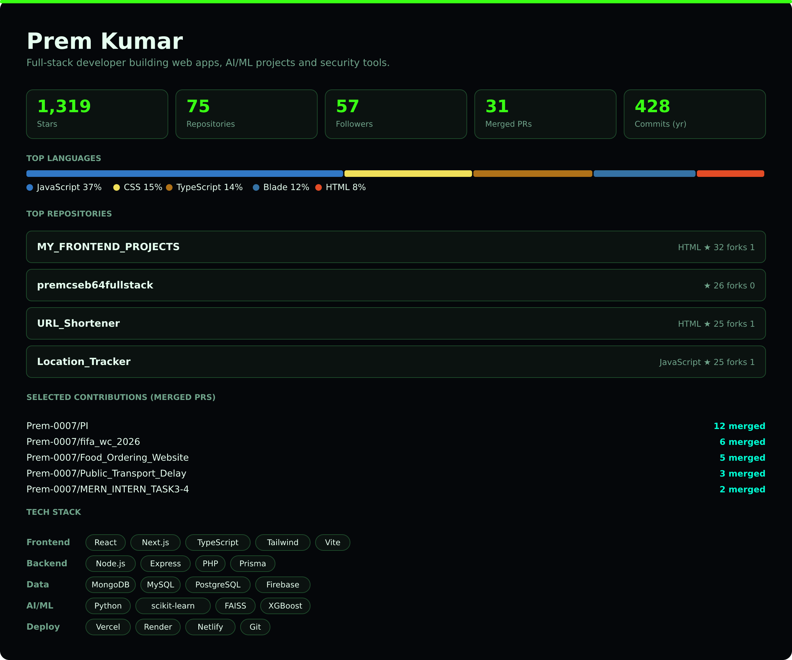

  

  

  
  
  
  
  

  

<picture>
  <source media="(max-width: 600px)" srcset="./assets/public-builder-profile-mobile-dark.png" />
  
</picture>

Public statistics refresh automatically. <a href="./RANKING.md">Sources and methodology</a>.

## `>_ about_me`

- 🎓 B.Tech CSE student at **ANITS, Visakhapatnam** (2024–2028)
- 💻 Building full-stack apps with the **MERN stack**, **Next.js** and **PHP**
- 🤖 Exploring **AI/ML**: threat detection, forecasting and RAG-based agents
- 🛡️ Built **SentinelNet**, an AI-powered network threat detection platform, for the Omnikon National Hackathon 2026
- 🧠 Practicing **DSA in Java** and SQL problem-solving
- 📱 Mobile-first workflow: I ship real projects straight from my phone (Termux + Colab)
- 🎯 Focused on becoming a Software Engineer

## `>_ experience`

- **Vault of Codes**: built and deployed six MERN apps with JWT/Firebase auth and role-based access control
- **Edunet Foundation × IBM SkillsBuild (AI/ML)**: threat & intrusion profiler and sales forecasting system
- **MERN Stack Internship**: shipped a full food delivery app with Stripe and an AI review analyzer
- **AI Software Engineer Internship**: built a college comparison and admissions prediction platform
- **Xyzon Innovations · InternSpark · InAmigos Foundation · 1M1B**: web security, design-to-code and sustainability AI work

## `>_ tech_stack`

**Frontend** 

**Backend** 

**Database** 

**Programming & AI/ML** 

**Deployment & tools** 

## `>_ featured_projects`

| Project | What it does | Stack |
|---|---|---|
| 🛡️ **SentinelNet** (`phishshield-ai-omnikon2026`) | AI-powered network threat detection platform, built for the Omnikon National Hackathon 2026 | Python, ML, Web |
| 🏫 **CollegeSphere** | College comparison, admissions predictor, mobile-responsive UI | Next.js 15, TypeScript, Tailwind, Prisma, Neon, Vercel |
| 🍔 **FoodRush** | Full food delivery app with Stripe payments and an AI review analyzer | MERN, Stripe |
| 📦 [**Inventory Management System**](https://inventory-management-system-4a65.vercel.app/login) ([repo](https://github.com/Prem-0007/Inventory_Management_System)) | Role-based inventory app with auth and dashboards | MERN, Vercel |
| 🔐 **Network Threat & Intrusion Profiler** | Intrusion detection on the NSL-KDD dataset | Python, Random Forest, Isolation Forest |
| 📈 **Sales Forecasting & Demand Intelligence** | EDA, forecasting, clustering and an interactive dashboard | SARIMA, Prophet, XGBoost, K-Means, Streamlit |
| 🎤 **Interview Trainer Agent** | RAG-based interview coach with ATS resume analysis and PDF export | IBM watsonx.ai, FAISS, HuggingFace |
| ♻️ **AI WasteWise** | Smart waste segregation & sustainability assistant (SDG 12 / 11 / 13) | React, Vite, LLM, Vercel |
| 💼 **CareerVerse** | Job portal backend | Node.js, Express |
| 🎓 **EventHive · EduSphere · MedCore · TastyBite · MES Control** | MERN apps with glassmorphic UI and dark/light mode | MERN |
| 🌐 [**Personal Portfolio**](https://prem-portfolio-six-tau.vercel.app) | Live portfolio with projects, experience and certifications | HTML, CSS, JS, Vercel |

[All repositories](https://github.com/Prem-0007?tab=repositories) · [All merged pull requests](https://github.com/search?q=author%3APrem-0007+is%3Apr+is%3Amerged+is%3Apublic&type=pullrequests)

## `>_ stats`

  

  

## `>_ contribution_snake`

  

<code>&gt; code • learn • build • repeat_</code>

