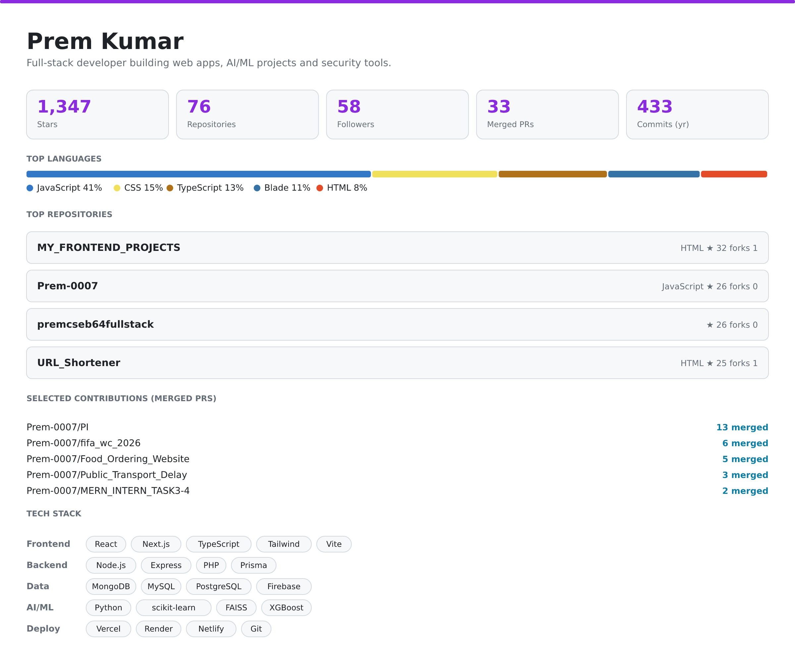

<a href="./assets/public-builder-profile.png#gh-light-mode-only">
<picture>
  <source media="(max-width: 600px)" srcset="./assets/public-builder-profile-mobile.png" />
  
</picture>
</a>
<a href="./assets/public-builder-profile-dark.png#gh-dark-mode-only">
<picture>
  <source media="(max-width: 600px)" srcset="./assets/public-builder-profile-mobile-dark.png" />
  
</picture>
</a>

[Portfolio](https://prem-portfolio-six-tau.vercel.app) · [Email](mailto:premkumarballa777@gmail.com) · [LeetCode](https://leetcode.com/u/Prem_0007/) · [Resume](https://jumpshare.com/share/0n1TcuyvK1GJkjkV8v8y)

[All repositories](https://github.com/Prem-0007?tab=repositories) · [All merged contributions](https://github.com/search?q=author%3APrem-0007+is%3Apr+is%3Amerged+is%3Apublic+-user%3APrem-0007&type=pullrequests)

Public statistics refresh automatically. <a href="./RANKING.md">Sources and methodology</a>.
